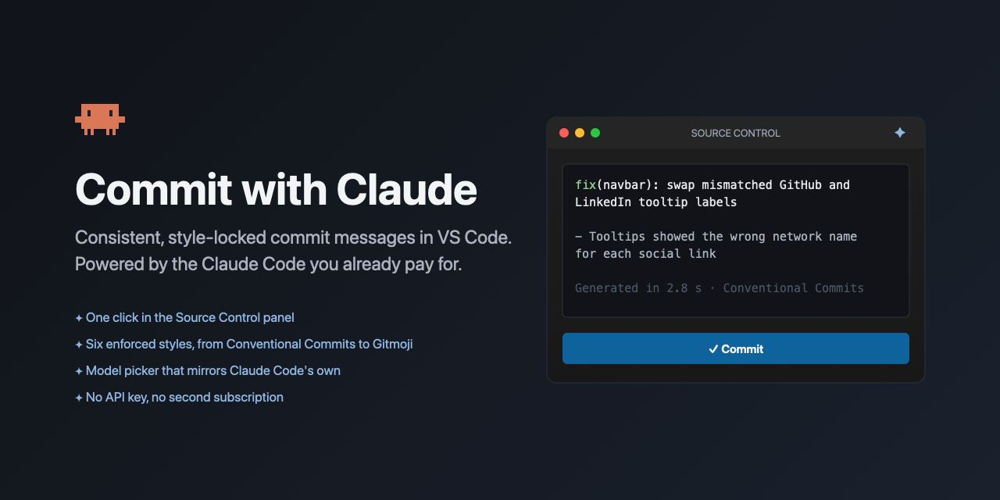

<p align="center">
  
</p>

<p align="center">
  <a href="https://marketplace.visualstudio.com/items?itemName=threetides.commit-with-claude"></a>
  <a href="https://marketplace.visualstudio.com/items?itemName=threetides.commit-with-claude"></a>
  <a href="https://marketplace.visualstudio.com/items?itemName=threetides.commit-with-claude&ssr=false#review-details"></a>
  <a href="https://github.com/threetides/commit-with-claude/actions/workflows/ci.yml"></a>
  <a href="LICENSE"></a>
</p>

<p align="center">
  <b>Already paying for Claude Code? Get consistent commit messages for free.</b><br>
  One click in the Source Control panel. Six enforced styles. A model picker that mirrors Claude Code's own. No API key.
</p>

<p align="center">
  <a href="vscode:extension/threetides.commit-with-claude"><b>Install in VS Code</b></a>
  &nbsp;·&nbsp;
  <a href="https://marketplace.visualstudio.com/items?itemName=threetides.commit-with-claude">Marketplace</a>
  &nbsp;·&nbsp;
  <a href="CHANGELOG.md">Changelog</a>
  &nbsp;·&nbsp;
  <a href="https://github.com/threetides/commit-with-claude/issues/new/choose">Report a bug</a>
</p>

---

## Why this one

Most AI commit message tools share two problems. The format drifts from one message to the next, and you can't choose the model. Commit with Claude fixes both, and runs on the Claude Code subscription you already have.

- **Styles are enforced, not suggested.** Each style is a JSON schema the model must fill plus a renderer that lays the fields out. The model decides *what to say*, the code decides *how it looks*. Subjects are always the right case, bullets always use the same marker, and the 50/72 style never exceeds 50 characters.
- **The model list is Claude Code's own.** The dropdown is read from the local catalog Claude Code keeps for its `/model` picker. "Default" uses whatever Claude Code is set to right now, so the two never disagree.
- **It's fast.** The CLI runs with no tools, no MCP servers and a purpose-built system prompt. Compared to a default invocation that cuts the prompt about 7×, the round trip about 2.5×, and removes thinking tokens entirely. Typical generation takes two to four seconds.
- **It knows your repo.** Your last few commit subjects are passed along so scopes and vocabulary match what's already in the history.

## Quick start

1. Install [Claude Code](https://claude.com/claude-code) and run `claude` once so it's signed in.
2. Install the extension: press <kbd>Cmd/Ctrl</kbd>+<kbd>P</kbd> and run `ext install threetides.commit-with-claude`.
3. Make a change, open Source Control, click the ✦ sparkle in the title bar. Read, edit if you like, commit.

Open the **Commit with Claude** view in the activity bar to pick a style and a model. Both are saved to your user settings, so they follow you across projects.

## Styles

All six examples below were generated from the same real change, a fix for two tooltips whose labels were swapped.

| Style | When to pick it |
|---|---|
| **Conventional Commits** | The default and the de facto standard. Works with semantic-release, commitlint and most changelog tooling. |
| **Conventional, scope required** | Same, but every message names the area it touches. Good for monorepos and larger apps. |
| **Angular** | The convention Conventional Commits grew out of. Stricter type list, prose body explaining *why*. |
| **Gitmoji** | An emoji up front signals the kind of change at a glance. Popular in open source and design-heavy teams. |
| **Classic 50/72** | The traditional git style. Capitalised subject, blank line, wrapped prose body. No type prefixes. |
| **One-liner** | A single capitalised subject line. For solo projects and quick iteration. |

<details>
<summary><b>Conventional Commits</b></summary>

```text
fix(ui): correct swapped social link tooltips

- GitHub and LinkedIn tooltip labels were attached to the wrong triggers
```
</details>

<details>
<summary><b>Conventional, scope required</b></summary>

```text
fix(navbar): swap mislabeled GitHub and LinkedIn tooltips
```
</details>

<details>
<summary><b>Angular</b></summary>

```text
fix(navbar): swap mismatched GitHub and LinkedIn tooltip labels

The social link tooltips were attached to the wrong triggers, so
hovering the GitHub link showed "LinkedIn" and vice versa. Each tooltip
now names the link it belongs to.
```
</details>

<details>
<summary><b>Gitmoji</b></summary>

```text
🐛 Fix swapped GitHub and LinkedIn tooltip labels
```
</details>

<details>
<summary><b>Classic 50/72</b></summary>

```text
Fix swapped GitHub and LinkedIn tooltips

The social link tooltips were attached to the wrong triggers, so
hovering the GitHub icon showed "LinkedIn" and vice versa. Swap the
labels so each tooltip matches its link, and correct the casing of
"GitHub".
```
</details>

<details>
<summary><b>One-liner</b></summary>

```text
Fix swapped GitHub and LinkedIn tooltip labels in social links
```
</details>

Want a body on every message, or never? Set `commitWithClaude.bodyMode`. Need something project-specific, like a ticket key in the footer? Put it in `commitWithClaude.extraInstructions`. A team can pin a style for one repository by setting `commitWithClaude.style` in workspace settings; the panel shows the override and edits that value instead of your personal one.

## Models

The model dropdown lists exactly what Claude Code's `/model` command offers on your account, read from Claude Code's local catalog cache. Pick **Default** to follow Claude Code's current setting, or pin one. The panel shows which model Default currently resolves to, and the last run's model and timing.

If the catalog can't be read, the dropdown falls back to the aliases the CLI documents: opus, sonnet, haiku.

## What the model sees

- The diff of your **staged** changes, or your unstaged plus untracked changes if nothing is staged.
- Your **branch name** and your last 12 **commit subjects**.
- Lockfiles, minified bundles, source maps, snapshots, and anything marked `linguist-generated` or `-diff` in `.gitattributes` are replaced by a one-line summary with line counts. The model still learns that dependencies changed, without reading 400 lines of lockfile. Add your own patterns with `commitWithClaude.ignoreGlobs`.
- Per-file and total size caps keep huge diffs from blowing the context.

Nothing is sent anywhere by the extension itself. Everything goes through your own Claude Code CLI session, under the terms of your Anthropic account. The extension stores no credentials and makes no network requests. See [SECURITY.md](SECURITY.md).

## Settings

| Setting | Default | What it does |
|---|---|---|
| `commitWithClaude.style` | `conventional` | Commit style. Set per workspace to enforce a convention. |
| `commitWithClaude.model` | `""` | Model id, or empty to follow Claude Code's current model. |
| `commitWithClaude.effort` | `low` | Effort level. Low was indistinguishable in quality for this task. |
| `commitWithClaude.bodyMode` | `auto` | `auto`, `always` or `never` include a body. |
| `commitWithClaude.language` | `English` | Language of the message. |
| `commitWithClaude.extraInstructions` | `""` | Extra rules appended to the prompt. |
| `commitWithClaude.recentCommitExamples` | `12` | Recent subjects shown to the model. 0 disables. |
| `commitWithClaude.ignoreGlobs` | `[]` | Additional files to summarise instead of include. |
| `commitWithClaude.maxFileDiffChars` | `12000` | Per-file diff cap. |
| `commitWithClaude.maxTotalDiffChars` | `80000` | Total diff cap. |
| `commitWithClaude.claudePath` | `""` | Path to `claude` if auto-detection fails. |
| `commitWithClaude.timeoutSeconds` | `90` | Give up after this long. |
| `commitWithClaude.debug` | `false` | Log prompts and raw replies to the output channel. |

## How it works

```
claude -p --output-format json --no-session-persistence \
       --tools "" --strict-mcp-config --disable-slash-commands \
       --effort low --system-prompt "<style rules + schema>" [--model <id>]
```

The prompt goes in on stdin. The reply is parsed as JSON and validated against the style's schema. If it doesn't validate, one retry is made with Claude Code's `--json-schema` flag, which guarantees the shape at the cost of a second round trip. The validated object is rendered to text by the style and placed in the commit box.

## Troubleshooting

**"Could not find the claude executable."** The extension looks in the usual install locations, your PATH, and your login shell. If Claude Code lives somewhere unusual, run `which claude` in a terminal and put the result in `commitWithClaude.claudePath`.

**"Not logged in."** Run `claude` in a terminal and complete the login. The extension uses that session.

**"No changes to describe."** There's nothing staged, modified, or untracked in the repository the button belongs to. In a multi-root workspace the sparkle acts on the repository whose Source Control section it sits in.

**The message ignores my style.** Check the panel: a workspace setting may be overriding your choice. Enable `commitWithClaude.debug` and run **Commit with Claude: Show Log** to see the exact prompt and reply.

**It's slow.** Generation should take two to four seconds. If it takes much longer, check the log for a strict-schema retry, which happens when the first reply didn't validate, and consider `commitWithClaude.effort` or a smaller model.

## FAQ

**Does it work in Cursor, Windsurf, or VSCodium?**
It works wherever the built-in Git extension and a signed-in Claude Code CLI exist. Install the VSIX from the [releases page](https://github.com/threetides/commit-with-claude/releases) until it's on Open VSX.

**Does it read my CLAUDE.md?**
No. The extension replaces Claude Code's system prompt with its own, so project instructions aren't loaded. Put commit-specific rules in `commitWithClaude.extraInstructions` instead.

**Does it use my Claude Code quota?**
Yes, the same way any `claude -p` call does. A typical generation is around three thousand input tokens and a hundred output tokens.

**Can I add a style?**
Yes, a style is about forty lines. See [CONTRIBUTING.md](CONTRIBUTING.md).

## Development

```bash
bun install
bun run build        # tsc
bun test             # unit tests for styles and glob matching
bun run package      # builds commit-with-claude-<version>.vsix
bun run install-local
```

Press F5 in VS Code to launch an Extension Development Host.

## License

MIT. Claude and Claude Code are trademarks of Anthropic, PBC. This project is an independent community extension and is not affiliated with or endorsed by Anthropic.
